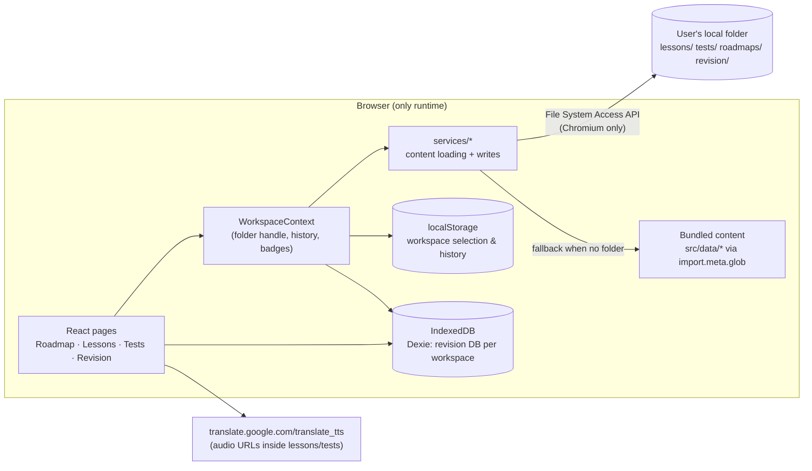

# Skill Map — Architecture

> Audience: developers and AI assistants. Read this before changing code.
> Last reviewed: 2026-10-10 against the code on branch `main`.

## 1. What the app is

Skill Map is a **client-side-only React + TypeScript web app** for language and skill learning. It has no backend in production. Everything runs in the browser.

Four views:

| View | File | Purpose |
|------|------|---------|
| Roadmap | `src/Roadmap.tsx` | Skill tree (React Flow) with YAML two-way sync, node completion, links to lessons/tests |
| Lessons | `src/Lessons.tsx` | Markdown lessons (+ embedded HTML/`<audio>`) in a folder tree |
| Tests | `src/Tests.tsx` | Multiple-choice quizzes from YAML, shuffled options, audio, review of wrong answers |
| Revision | `src/Revision.tsx` | Five-stage spaced repetition over previously answered questions |

Guiding principle: the app is a **language-learning helper, not a teacher**. Content is authored (often with AI) as plain files; the app just organises, quizzes and schedules review.

## 2. Tech stack

- React 19, TypeScript, Vite 8
- `vite-plugin-singlefile` (production build is a single HTML file)
- React Flow (`reactflow`) for the roadmap graph
- `react-markdown` + `rehype-raw` for lessons
- `@uiw/react-textarea-code-editor` for YAML editing
- `react-resizable-panels` for split panes
- Dexie (IndexedDB) for revision data
- `yaml` for parsing/serialising roadmaps, tests, structure files
- Oxlint, Playwright (regression), tsx-based unit test runner (`test-wrapper.ts`)

## 3. Repository layout

```
src/
  main.tsx                 React entry
  App.tsx                  Page switching, dark mode, unsaved-roadmap guard, deep links
  Roadmap.tsx / Lessons.tsx / Tests.tsx / Revision.tsx   The four pages
  components/              UI pieces (TopBar, AnswerQuestion, QuestionTracker, SkillNode, Sidebar/…)
  hooks/                   Graph parse/serialise, auto-layout, audio auto-advance, YAML sync, panel resize
  contexts/
    WorkspaceContext.tsx   Selected folder handle, history, revision due-count badges
  services/                Anything touching storage or content loading
    workspace.ts           Loads lessons/tests/roadmaps/structure (workspace folder, else bundled data)
    workspaceRoadmapPersistence.ts    Writes roadmap YAML into the workspace folder
    workspaceStructurePersistence.ts  Writes structure.yaml into the workspace folder
  utils/                   Pure-ish logic + browser helpers
    revision.ts            Dexie schema, proficiency levels, intervals, export/import
    testScoring.ts         Counting correct answers
    folderStructure.ts     Folder tree model for lessons/tests
    contentCatalog.ts      Catalog builders for pickers
    lessonMarkdown.tsx     Markdown renderer
    audioProxy.ts          Rewrites Google Translate TTS URLs to /api/audio-proxy (dev only)
    workspacePersistence.ts  localStorage + IndexedDB storage of the folder handle and history
    unsavedChanges.ts      Navigation guard rules
  data/                    Bundled demo content (roadmaps/, lessons/, tests/) — loaded with import.meta.glob
  db/                      Re-exports of the revision DB API + row type
  api/save-question-result.ts   Not wired to anything (see §9)
  server.ts                Empty placeholder (see §9)
vite.config.ts             Vite config + dev/preview middleware plugins
regression/                Playwright browser tests
dev_helper_script/         Jupyter notebooks for generating/validating content (audio URLs, YAML checks)
AI_content_generator_full_prompt_guide.md   Prompt + schema for AI-generated roadmaps, lessons, tests
```

## 4. Runtime architecture (today)



### 4.1 Content loading

`src/services/workspace.ts` → `loadWorkspaceContent(handle?)`:

1. If a workspace folder handle exists, read `lessons/`, `tests/`, `roadmaps/`, plus `structure.yaml` files from it.
2. Otherwise (or on failure) use the bundled defaults from `src/data/`, which are compiled into the build via `import.meta.glob(..., { query: '?raw', eager: true })`.

Formats:

- **Lesson**: `lessons/<id>.md`. Title = first `# heading`. Tree defined by `lessons/structure.yaml`.
- **Test**: `tests/<id>.yaml` with `quiz_title` and `questions[]` (`question_number`, `question`, `options`, `correct_answer`, optional `explanation`, `audio_track_url`). Folders via `tests/structure.yaml`.
- **Roadmap**: `roadmaps/<id>.yaml`, a list of nodes (`id`, `label`, `x`, `y`, `finished`, `description`, `dependsOn`, `lessons`, `tests`, `url`, `children`). Parsed by `useGraphParser`, serialised back by `useYamlSync`.

### 4.2 Writing back

`workspaceRoadmapPersistence.ts` and `workspaceStructurePersistence.ts` write directly into the chosen folder through the File System Access API (`getDirectoryHandle` / `getFileHandle` / `createWritable`). There is no server call.

### 4.3 Revision (spaced repetition)

- Stored in **Dexie** (`revision.ts`), one IndexedDB database per workspace. Rows are `CompletedQuestionRecord` (`question_name`, `options`, `correct_answer`, `selected_answer`, `correct`, `last_time`, `next_revision_time`, `proficiency`, `quiz_title`, `audio_track_url`, `hash`).
- Proficiency levels `1.1 … 5.3` (22 sub-levels). Stage intervals: 8h, 24h, 48h, 72h, 168h.
- Correct answer advances within a stage; wrong answer drops back to the start of the previous stage.
- Completing a revision session writes a snapshot into the workspace's `revision/` folder. Manual JSON export/import is also available.

**Key limitation:** IndexedDB lives in one browser profile on one device. Progress made on a PC is invisible on a phone. This is the central problem for mobile use (see the ideas document in §10).

### 4.4 Workspace persistence

`utils/workspacePersistence.ts`:

- `localStorage` keys `skill-map.workspace-selection` and `skill-map.workspace-history` hold name and path.
- A separate IndexedDB database `skill-map-workspace-db` stores the `FileSystemDirectoryHandle` objects, because handles can be stored in IndexedDB but not in localStorage.
- Browsers may require the user to re-grant permission on each visit. The UI has to handle that.

### 4.5 Audio

- Lessons and tests reference audio as Google Translate TTS URLs (`translate.google.com/translate_tts?...`).
- `utils/audioProxy.ts` rewrites those URLs to `/api/audio-proxy?url=…`. That route exists only in the Vite dev and preview servers (`vite.config.ts`).
- `hooks/useAudioAutoAdvance.ts` waits for the audio to finish before advancing a quiz question.

## 5. Build and run

| Command | What it does |
|---------|--------------|
| `npm run dev` | Vite dev server on `:5173`, with middleware plugins (see §6) |
| `npm run build` | `tsc -b` then `vite build` → single-file HTML in `dist/` |
| `npm run preview` | Serves the build with the same middleware |
| `npm run lint` | Oxlint |
| `npm test` | Runs `*.test.ts(x)` in `src/` and `regression/` via `test-wrapper.ts` |

## 6. Vite middleware (dev and preview only)

Defined in `vite.config.ts`. None of these exist in the static production build.

| Route | Method | Purpose |
|-------|--------|---------|
| `/api/save-roadmap` | POST | Writes YAML to `src/data/roadmaps/` |
| `/api/save-test-result` | POST | Writes quiz results to `src/data/tests/result/` |
| `/api/save-structure` | POST | Writes `structure.yaml` into `src/data/<kind>/` |
| `/api/audio-proxy` | GET | Proxies remote audio to avoid CORS on `fetch` |

The frontend currently does not call the three `save-*` routes. Writes go through the File System Access API instead (§4.2). Treat those routes as legacy.

## 7. Hosting and deployment

Today: no hosted deployment. The app runs locally with `npm run dev`.

The production build is static (HTML/JS/CSS, no server logic). It can be hosted on any static host. The only runtime dependency beyond the bundle is the external audio URL.

## 8. Platform constraints (important for mobile)

| Capability | Used for | Desktop Chrome/Edge | Firefox / Safari | Phone browsers |
|-----------|----------|---------------------|------------------|----------------|
| File System Access (`showDirectoryPicker`) | Reading/writing a user folder | Yes | No | Generally no (verify on your device) |
| IndexedDB | Revision DB, folder handles | Yes | Yes | Yes |
| Service Worker | Offline app shell (PWA) | Yes | Yes (limited) | Yes |
| Origin Private File System (OPFS) | Browser-private file storage | Yes | Yes (recent) | Yes |
| Web Speech API (`speechSynthesis`) | Offline TTS | Yes | Yes | Yes (voices vary) |

Consequence: on a phone, the app cannot open a folder the way the desktop does. Mobile needs another content source (see §10).

## 9. Known issues and cleanup candidates

1. `src/server.ts` is an empty `export {}`.
2. `src/api/save-question-result.ts` looks like a Next.js-style handler and is not wired to any route.
3. `drizzle.config.ts` points to SQLite, but no `drizzle/` folder exists and nothing uses Drizzle. `src/db/schema.ts` only exports an interface. Looks like leftover scaffolding.
4. The three `save-*` middleware routes in `vite.config.ts` are unused by the frontend (§6).
5. Audio depends on an unofficial Google Translate endpoint. That is fragile, and its terms of use do not clearly allow redistribution in a public open-source project.
6. Revision progress is per browser profile (§4.3), so it cannot sync between devices.
7. `README.md` says the app is "local-first with no separate backend service". That is still true, and this doc is the more detailed reference.

## 10. Target architecture (goal: web app for PC and mobile, zero cost, open source)

### 10.1 Goals

- One codebase, one URL, installable on phones (PWA), usable offline for revision.
- Zero recurring cost: static hosting only, no server.
- Progress that follows the user across devices.
- Content can be shared as plain files (packs), not only as code.
- Desktop keeps the folder workflow. Mobile gets a simpler workflow with the same data.

### 10.2 Layered design

```
┌───────────────────────────────────────────────────────────┐
│ UI (responsive React)                                     │
│  Desktop: roadmap graph + YAML editor                     │
│  Mobile:  roadmap as tree/list, lesson reader, quiz,      │
│           revision (large touch targets)                  │
├───────────────────────────────────────────────────────────┤
│ Core (pure TypeScript, no DOM, no storage)                │
│  schemas (zod or hand-written validators)                 │
│  parsers/serialisers: roadmap, lesson, test, structure    │
│  scoring, proficiency engine, next-review time            │
│  progress events → derived state                          │
├───────────────────────────────────────────────────────────┤
│ Content source adapters  (same interface)                 │
│  FolderSource   File System Access (desktop Chromium)     │
│  ZipSource      import/export a .zip pack (any device)    │
│  OpfsSource     browser-private copy for offline (PWA)    │
│  BundledSource  src/data/ demo content                    │
│  UrlSource      packs from a GitHub repo or raw URL       │
├───────────────────────────────────────────────────────────┤
│ Progress sync adapters                                    │
│  Local IndexedDB  (always on, fast, offline)              │
│  Export/import    progress-*.json (manual, always works)  │
│  Google Drive     one JSON file in the user's Drive,      │
│                   client-side only (Google Identity +     │
│                   Drive API), no server needed            │
├───────────────────────────────────────────────────────────┤
│ Platform                                                  │
│  Service worker (offline shell, cache content + audio)    │
│  Web Speech API fallback for audio                        │
└───────────────────────────────────────────────────────────┘
```

Rules that keep this manageable:

- UI components never call `FileSystemDirectoryHandle` or Dexie directly. They call a `ContentSource` or `ProgressStore` interface.
- Core logic has no imports from React, Dexie or the File System Access API. That makes it testable with `npm test` and reusable.
- Progress is stored as **append-only events** (e.g. `{ questionHash, at, correct, deviceId }`) instead of mutable rows. Merging two devices is then a union of events, which avoids most conflicts. Proficiency is recomputed from events.

### 10.3 Data model for progress (proposed)

```jsonc
// progress-<userId>.json  (one file, stored in Drive or exported by hand)
{
  "version": 1,
  "events": [
    { "id": "d1-000123", "deviceId": "pc-homer", "at": "2026-10-10T08:00:00Z",
      "questionHash": "a3f9…", "pack": "spanish-travel", "correct": true }
  ]
}
```

Dedupe by `id`. Recompute proficiency per question from its events in time order. This is the same Leitner logic as today, just derived from history.

### 10.4 Mobile without a folder

Three options, in order of effort:

1. **Zip pack import/export.** Desktop exports a `.zip` (lessons, tests, roadmaps, progress). Phone imports it. Works everywhere. Lowest risk.
2. **OPFS workspace.** The phone keeps its own copy of the pack in the browser's private storage, and the PWA caches it for offline use.
3. **Drive sync.** Both devices read and write the same `progress-*.json` in Google Drive via the client-side Drive API. Free for personal use. Needs a Google OAuth client ID but no backend.

### 10.5 Responsive UI

- Keep the same routes. Use CSS breakpoints and a `useMediaQuery` hook.
- On narrow screens:
  - Roadmap: render as an indented list (the data is already a tree), not a draggable graph. Editing stays desktop-only.
  - Tests and Revision: single column, large answer buttons, audio controls at the bottom.
  - Lessons: reader mode with a collapsible table of contents.
- Use `100dvh` and safe-area insets. Avoid hover-only interactions.

### 10.6 Offline and PWA

- Add `vite-plugin-pwa` (Workbox). It generates a manifest and a service worker.
- Precache the app shell and bundled content.
- For audio: either cache the MP3s the first time they play (Cache API), or generate them once with an offline TTS tool and ship them with the pack. Do not rely on the Google endpoint for offline use.

### 10.7 Hosting at zero cost

| Option | Cost | Notes |
|--------|------|-------|
| GitHub Pages | Free for public repos | Deploy from GitHub Actions on push to `main`. Simplest fit. |
| Cloudflare Pages | Free tier | Good performance, preview deploys per branch |
| Netlify / Vercel | Free tier | Fine, but limits can change |

All three serve static files. No server, no database, no monthly cost. Use "static-only" as a hard rule in the codebase: any feature that needs a backend goes behind an optional adapter, never a requirement.

### 10.8 Sharing content (open-source knowledge packs)

- A **pack** is a folder or zip with `pack.yaml` (title, language, author, licence), `roadmaps/`, `lessons/`, `tests/`, and optional `audio/`.
- Packs live in public Git repos. Anyone can fork, edit and submit a pull request.
- A registry is a JSON index file in a Git repo, for example `registry.json` listing pack URLs. The app fetches it and offers "Install pack". No database.
- Import by URL: `?pack=<raw-url>` loads a pack from GitHub raw.
- Add a `licence` field to every pack. Content generated with AI should say so and give the prompt version used.
- Schema validation runs in CI (GitHub Actions, free for public repos) using the same validators as the app core.

### 10.9 Suggested migration order

1. Extract `core/` (validators, scoring, proficiency) from `utils/` and `services/`. Add tests. No behaviour change.
2. Introduce `ContentSource` and `ProgressStore` interfaces. Wrap the current folder and Dexie code behind them.
3. Replace the Dexie row model with the event log (§10.3) and write a migration from existing `revision` data.
4. Add zip import/export and the responsive layouts (§10.4, §10.5).
5. Add the PWA layer and cache audio (§10.6).
6. Add Drive sync as an optional adapter (§10.4 option 3).
7. Deploy the static build to GitHub Pages (§10.7) and document the pack format for contributors.
8. Remove the dead code listed in §9.

## 11. Conventions for contributors and AI assistants

- Content first: lessons and tests are plain Markdown/YAML. Do not hardcode learning content in TypeScript.
- Keep the app static. Do not add a backend dependency without a fallback that works without it.
- Do not add a feature that writes outside the workspace folder or the app's own storage.
- New storage code goes behind an adapter interface (§10.2), not inside a page component.
- When changing the content format, update `AI_content_generator_full_prompt_guide.md` and `README.md` in the same change.
- Run `npm run lint` and `npm test` before committing.
